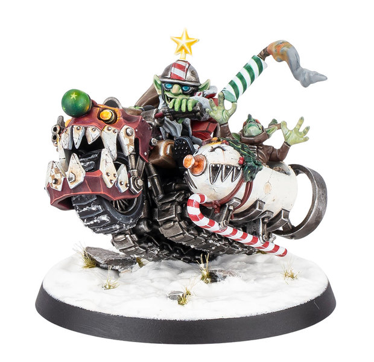

# Da Red Gobbo's Squigmobile

{ width=620 height=600 }

| Cost | MA | ST | AG | PA | AV |
| ---- | -- | -- | -- | -- | --- |
| **200K** | 5 | 6 | 5+ | - | 10+ |

*(Big Guy, Goblin, Special)*

* [Bombardier]
* [Break Tackle]
* [Dirty Player]
* [Hail Mary Pass]
* [Hatred] (Dwarf)
* [Juggernaut]
* [Loner] (4+)
* [Mighty Blow]
* [No Ball]
* [Secret Weapon]
* [Stand Firm]
* **Have a Present, Ya Git**

A team with the Red Gobbo gains an additional [Bribe] for each half. If the Bribe is not used in a half, it is lost.

### Plays For

* Any team except a [Dwarf] team

### Exhibition Play Only

If both coaches agree, Da Red Gobbo's Squigmobile can be hired as a Star Player during Exhibition Play. He cannot be used in either League Play or Matched Play.

### Accept to play for...

* [Amazon]
* [Black Orc]
* [Bretonnian]
* [Chaos Chosen]
* [Chaos Dwarf]
* [Chaos Renegades]
* [Dark Elf]
* [Elven Union]
* [Gnome]
* [Goblin]
* [Halfling]
* [High Elf]
* [Human]
* [Imperial Nobility]
* [Khorne]
* [Lizardmen]
* [Necromantic Horror]
* [Norse]
* [Nurgle]
* [Ogre]
* [Old World Alliance]
* [Orc]
* [Shambling Undead]
* [Skaven]
* [Snotling]
* [Tomb Kings]
* [Underworld Denizens]
* [Vampire]
* [Wood Elf]
