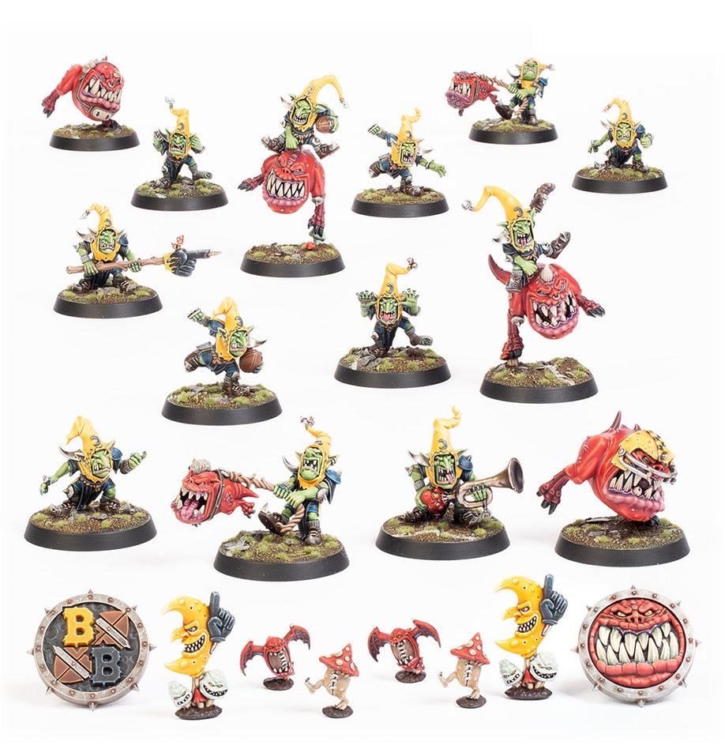

{ width=918 height=948 }

### Positionals

| Qty  | Position                                  | MA | ST | AG | PA | AV  | Skills & Traits                                                                                                              | Primary | Secondary | Cost |
| ---- | ----------------------------------------- | -- | -- | -- | -- | --- | ---------------------------------------------------------------------------------------------------------------------------- | ------- | --------- | ---- |
| 0‑16 | Night Goblin Lineman *(Goblin, Lineman)*  | 6  | 2  | 3+ | 4+ | 8+  | • [Dodge] • [Right Stuff] • [Shadowing] • [Stunty] • [Taunt]                                                     | A D     | G P S     | 45K  |
| 0‑2  | Squig Herder *(Goblin, Special)*          | 6  | 2  | 3+ | 5+ | 8+  | • [Dodge] • [Disturbing Presence] • [Fend] • [Squig Restraint] • [Stunty]                                        | A D     | G P S     | 55K  |
| 0‑2  | Squig Hopper *(Goblin, Special, Squig)*   | 7  | 3  | 3+ | 4+ | 8+  | • [Dodge] • [Jump Up] • [Monstrous Mouth] • [Pogo] • [Squig Rage]                                                | A D     | G P S     | 80K  |
| 0‑2  | Squig Wrangler *(Goblin, Special, Squig)* | 3  | 7  | 3+ | -  | 8+  | • [Ball & Chain] • [No Ball] • [Squig Rage] • [Stunty]                                                              | D S     | A G       | 70K  |
| 0‑2  | Cave Squig *(Special, Squig)*             | 6  | 4  | 3+ | -  | 9+  | • [Frenzy] • [Jump Up] • [Monstrous Mouth] • [No Ball] • [Pogo] • [Squig Rage]                                | -       | A D G S   | 85K  |
| 0‑1  | Trained Troll *(Big Guy, Troll)*          | 4  | 5  | 5+ | 5+ | 10+ | • [Always Hungry] • [Mighty Blow] • [Projectile Vomit] • [Really Stupid] • [Regeneration] • [Throw Team-mate] | S       | A G P     | 115K |

### League

* [Underworld Challenge]

### Special Rules

* [Bribery and Corruption]

### Staff

* [Cheerleader] - 10K
* [Assistant Coach] - 10K
* [Apothecary] - 50K
* [Re-roll] - 70K

### Star Players

* [Akhorne the Squirrel] - 80K
* [Bomber Dribblesnot] - 80K
* [Fungus the Loon] - 80K
* [Nobbla Blackwart] - 120K
* [Scrappa Sorehead] - 120K
* [Skitter Stab-Stab] - 170K
* [Glart Smashrip] - 175K
* [Kreek Rustgouger] - 180K
* [Hakflem Skuttlespike] - 200K
* [Da Red Gobbo's Squigmobile] - 200K
* [The Black Gobbo] - 210K
* [Grak and Crumbleberry] - 250K
* [Ripper Bolgrot] - 250K
* [Morg 'n' Thorg] - 340K

### Inducements

* [Temp Agency Cheerleader] - 5K
* [Prayers to Nuffle] - 10K
* [Part-time Assistant Coach] - 20K
* [Team Mascot] - 25K
* [Weather Mage] - 25K
* [Mercenary Player] - 30K
* [Blitzer's Best Keg] - 50K
* [Bribe] - 50K
* [Biased Referee] - 80K
* [Extra Team Training] - 100K
* [Infamous Coaching Staff] - 100K
* [Wandering Apothecary] - 100K
* [Wizard] - 150K
* [Halfling Master Chef] - 300K
